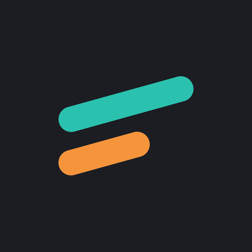

<p align="center">
  
</p>

<h1 align="center">SpendSense</h1>

<p align="center"><b>Track every expense. Know what was needed. Cut what wasn't.</b></p>

<p align="center">
  
  
  
  
  
</p>

SpendSense is an **offline-first Android app** that tags every expense as **Needed** (Required) or **Wasted** (Non-Required, the "Mal" expense), records the money you receive (pocket money or income), and turns both into **weekly, monthly and custom-range reports**.

Your data stays on your phone, encrypted, and the app has **no internet permission at all**.

> **Working title.** The final app name is still undecided, so "SpendSense" may change.

---

## Why SpendSense

Most expense apps answer *"where did my money go?"* by category. SpendSense answers a sharper question: **"How much of my money went to things I actually needed?"**

It is built for students first (small, frequent UPI and cash expenses, monthly pocket money), and works just as well for working professionals who want a clear view of income, spending and savings.

---

## Features

| Area | What you get |
|---|---|
| **Need vs Waste** | Every expense is tagged Need or Waste. The type belongs to the expense, not the category, so the same tea can be a Need today and a Waste tomorrow. Categories only suggest a default |
| **Income tracking** | Record pocket money, salary, stipend, scholarship and more. Choose a profile (Student, Working professional, Other) and labels adapt to you |
| **Balance and savings** | Available balance (with an optional opening balance), net, savings rate, spend rate and a days-left estimate |
| **Analysis** | Week, Month and **Custom range** views with quick presets (Today, Last 7 / 30 days, This month, Last month, Last 3 months, This year) and a date range picker |
| **Charts** | Donut charts by category, line chart of income vs expense, stacked Need/Waste bars, a mini Need vs Waste donut on Home. Every chart has a "View as table" alternative |
| **Reports** | Export any range as a **PDF** (A4) or **CSV**, then save or share. Notes are left out unless you opt in |
| **Categories** | **45 expense categories** in 9 groups and **14 income sources**, with search, recents and your own custom ones. Archive anything you don't use |
| **Budget** | Monthly budget plus an optional Waste limit, with warnings at 80% and 100% |
| **History** | All / Expenses / Income tabs, search, filters, sticky day headers, swipe to delete with Undo |
| **Reminders** | Daily logging reminder, weekly and monthly summaries, and a backup reminder after 30 days |
| **Quick actions** | Center "+" speed dial (Add expense / Add income) and launcher shortcuts |
| **Themes** | System, Light, Dark, Pure black (AMOLED) and optional Material You dynamic color |
| **Accessibility** | TalkBack labels, 48 dp touch targets, font scaling, and Need/Waste always shown with an icon and a label, never by color alone |

### How "Need vs Waste" works

> **The decision test:** *If I skipped this for a month, would my studies, health or basic living suffer?*
> Yes means **Need**. No means **Waste**.

The wording is deliberately neutral. "Waste" is a label to help you notice habits, not a judgment.

---

## Privacy and security

Privacy is the core promise of the app, not an add-on.

| Protection | Details |
|---|---|
| **No internet** | The app does not request the INTERNET permission. There are no analytics, ads or crash-reporting SDKs |
| **Encrypted database** | All data is stored in an AES-256 encrypted SQLCipher database. The key is random, encrypted with Google Tink, and protected by the Android Keystore |
| **App lock** | PIN (4 to 6 digits) and/or biometrics, auto-lock timeout, and persistent lockout after repeated wrong PINs. While locked, no app content is even composed |
| **Screen protection** | Screenshot and recents-preview blocking, on by default and switchable |
| **Hide amounts** | One tap masks all amounts on Home |
| **Private notifications** | Optional setting that keeps amounts out of lock-screen notifications |
| **Encrypted backups** | Password-protected `.ssbackup` files (AES-256-GCM, key derived with PBKDF2-HMAC-SHA256, authenticated header) |
| **No cloud backup** | Android Auto Backup is disabled on purpose |
| **Secure wipe** | "Delete all data" removes the database, keys, settings and caches |

**Honest limits.** Encryption protects data at rest on a device that has not been compromised. It cannot protect against malware with root access, someone who knows your PIN and holds your unlocked phone, or a photo of your screen. See [`PRIVACY.md`](PRIVACY.md) for the full details.

> **Back up before you uninstall or change phones.** The database key is tied to your device and cloud backup is off, so uninstalling the app deletes your data. Use *Settings > Privacy and Security > Encrypted backup* (or the CSV/JSON export) first.

---

## Tech stack

| Concern | Choice |
|---|---|
| Language / UI | Kotlin, Jetpack Compose, Material 3 |
| Architecture | MVVM with presentation / domain / data layers, unidirectional data flow |
| Storage | Room with SQLCipher (`sqlcipher-android`), DataStore for settings |
| Security | Google Tink + Android Keystore, AndroidX Biometric, PBKDF2, AES-GCM |
| DI | Hilt |
| Background work | WorkManager (reminders, summaries, purge) |
| Navigation | Navigation Compose |
| Serialization | kotlinx.serialization (JSON backup, schema version 2) |
| Charts | Custom Compose Canvas charts (no third-party chart library) |
| Reports | Android `PdfDocument` (no PDF library) |
| Splash | AndroidX Core SplashScreen |
| Build | Gradle (Kotlin DSL) with a version catalog, KSP, R8 |
| Testing | JUnit and MockK (236 unit tests), Compose UI tests |
| Min SDK | 26 (Android 8.0) |

### Project layout

```
app/src/main/java/com/supernovea/spendsense/
├── core/       design system, navigation, security, utilities
├── domain/     models, use cases, repository interfaces, AnalyticsEngine (pure Kotlin)
├── data/       Room (DAOs, entities, migrations), DataStore, repositories, export/backup
├── feature/    home, addexpense, history, analysis, budget, categories, settings, onboarding
└── work/       reminder and summary workers, notifications
```

Key design rules (full list in [`Rules.md`](Rules.md)): money is stored as `Long` paise (never floating point), the domain layer has no Android imports, all analytics formulas live only in `AnalyticsEngine`, and no amounts, notes or category names are ever logged.

---

## Getting started

### Requirements
- Android Studio (latest stable)
- **JDK 21** (Eclipse Temurin recommended)
- Android SDK with the latest stable platform
- An Android 8.0+ device or emulator

### Build and run
```bash
git clone <your-repo-url>
cd <repo-folder>

# Debug build
./gradlew assembleDebug            # Windows: .\gradlew.bat assembleDebug

# Unit tests and lint
./gradlew testDebugUnitTest lintDebug
```

Open the folder in Android Studio and press **Run**, or install the debug APK with `adb install`.

### Release build
```bash
./gradlew assembleRelease          # R8 shrinking and resource shrinking enabled
```

> **Signing.** The project currently signs release builds with the **debug keystore** so that release builds can be tested. Before sharing builds with other people, create your own release keystore, keep it **out of git** (`keystore.properties` is git-ignored) and sign with it. See [`Update.md`](Update.md) section 10 for the full checklist.

### Installing an APK
SpendSense is **not on Google Play yet**. When you install an APK from outside the Play Store, Android shows its normal "install unknown apps" prompt, and Play Protect may show an extra warning for apps it does not know. The app asks for no internet, SMS, contacts, storage or location access. **Do not turn off Play Protect** to install it. Installing over USB with `adb install` avoids these prompts.

---

## Documentation

| File | Purpose |
|---|---|
| [`PRIVACY.md`](PRIVACY.md) | Privacy and security details |
| [`CHANGELOG.md`](CHANGELOG.md) | Version history |
| [`Company_Organization(credits).md`](<Company_Organization(credits).md>) | Ownership, credits and third-party licenses |

---

## Roadmap

**Next**
- Recurring income and expenses (WorkManager)
- Month-end spend forecast and unusual-expense flag
- Clean Day streak and a user-set Waste Ratio target
- Quick-add templates and a home-screen widget
- Adaptive layouts for tablets and foldables

**Later**
- On-device Need/Waste suggestion from the note text
- Split transactions
- Malayalam and Hindi localization, multi-currency
- Optional, opt-in encrypted cloud backup

Everything on the roadmap keeps the same promise: no tracking, and nothing leaves the device without an explicit opt-in.

---

## Status

**Current release: v1.1.0** (2026-10-16). Verified with 236 passing unit tests, 0 lint errors and no INTERNET permission in the merged manifest. See [`CHANGELOG.md`](CHANGELOG.md) for what changed in each version.

---

## Credits

**Built by Adithiyan V R at Supernovea.**

Open-source components used (Kotlin, Jetpack, Hilt, SQLCipher for Android, Tink, Inter typeface, Material Symbols and more) are listed with their licenses in [`Company_Organization(credits).md`](<Company_Organization(credits).md>).

## License

Copyright © 2026 Supernovea. All rights reserved.

A source-code license has not been chosen yet. Until one is added, no permission is granted to copy, modify or redistribute this code.

<!--
SCREENSHOTS (add once captured, then delete this comment):
Screenshot protection is ON by default and blocks screenshots. Turn it off temporarily in
Settings > Privacy and Security, or capture on an emulator with a debug build.

| Home | Add | Analysis | Report |
|---|---|---|---|
|  |  |  |  |
-->
